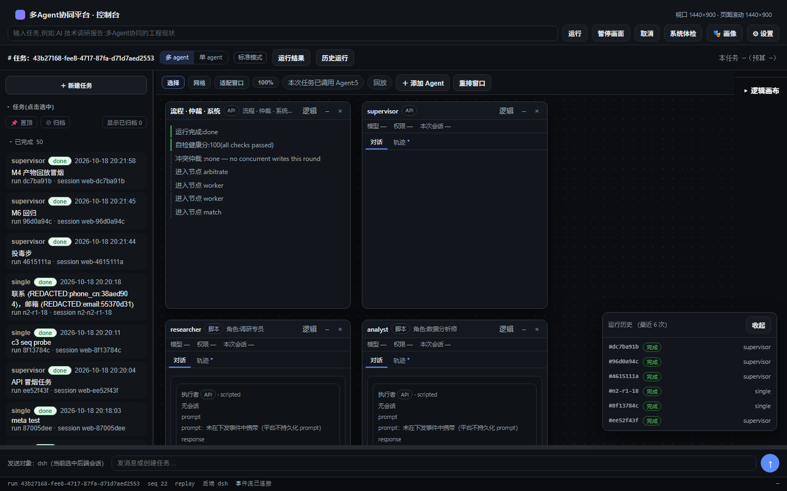

# multi_agent_collab — a modular, multi-mode multi-agent platform

An experimental platform for running **multiple agents with real roles, real backends and a
real permission gate** — not a chat wrapper.

- **Orchestration**: LangGraph-style topology runner (supervisor / debate / pipeline / single)
- **Execution**: CrewAI (model API) **or** a native ACP backend (`dsh`) over stdio — same event contract
- **Roles**: 9 agent cards in `configs/agents.yaml`; a registry maps **real agent ids → backends**
- **Governance**: permission cards in the agent's own window (server-offered options only, 45 s
  auto-reject → `spi_permission_expired`), append-only traces, evidence-ranked capabilities
- **Console**: single-page dark UI (FastAPI + vanilla JS), live SSE + replay, seven derived states

> Status: **alpha / research**. It runs end-to-end (784 tests, five gates) but the APIs and
> UI are still moving. See [HELP_WANTED.md](HELP_WANTED.md) for the parts we most want review on.



## What is actually proven

| Claim | Evidence |
|---|---|
| CrewAI path executes for real | `agent_card.executor=crewai`, `model=deepseek-chat` |
| Native path executes for real | `hetero_dispatch_result.audit_refs.backend_session_id` non-null (`end_turn`) |
| Permission flow is real | request → answer → `permission_answered`; unanswered → 45 s auto-reject |
| Capabilities are measured, not assumed | `usage_shape=context_used_size`, `supports_resume=true` (`measured@…`) |
| Gates | `pytest` 784 cases, `ledgercheck`, `audit_invariants`, `layercheck`, `ui_mutation` |

Honest limits: Windows-first; the `wb` backend is a disabled skeleton; cost/billing is not
implemented (the UI shows `—`); the browser test harness covers drag/resize/focus/permission only.

## Quickstart

```bash
python -m venv .venv
# Windows: .venv\Scripts\activate    Linux/macOS: source .venv/bin/activate
pip install -r requirements.txt

cp .env.example .env        # optional; without a key the platform runs in offline mode
python main.py doctor       # self-check
python server.py            # http://127.0.0.1:8000
```

Offline mode uses a scripted runtime and a `FakeLLM`; nothing leaves the machine.

A native backend (`dsh`) additionally needs `DSH_BIN` pointing at its `bin.js` and a compatible
`DSH_EXPECTED_VERSION`. Without it the platform stays on the CrewAI/scripted path.

## Architecture (one screen)

```
            ┌─────────────── FastAPI ───────────────┐
 console ──▶│ /api/runs /events(SSE) /artifacts     │──▶ event contract v2
 (vanilla)  │ /api/backends /api/modes /permission  │      (agent_card, agent_output, …)
            └───────────────┬───────────────────────┘
                            │
                  topology runner (LangGraph-ish)
                            │
             ┌──────────────┴──────────────┐
        CrewAI runtime                 hetero pre-pass
        (model API)                    (routing.map → backends)
                                             │
                                      ACP over stdio (dsh)
```

Key docs: `docs/dispatch-contract.md`, `docs/ui-enums.md`, `docs/evidence-policy.md`,
`docs/real_machine_smoke.md`.

The original Chinese README is kept as [README.zh-CN.md](README.zh-CN.md).

## Repository layout

| Path | What |
|---|---|
| `graphs/` | topology runner and graph builder (events, roles) |
| `agent_bridge/` | backend SPI, registry, factory, negotiation, probes, evidence |
| `dsh_bridge/` | ACP client/session (native backend plumbing) |
| `api/` | FastAPI routes + `static/` console |
| `core/` | matching, redaction, memory, storage |
| `crews/`, `evolver/`, `inspector/` | CrewAI factory, self-evolution, self-checks |
| `tests/` | 784 tests incl. a Playwright-driven UI smoke suite |

## Contributing & help

- Development setup, gates and conventions: [CONTRIBUTING.md](CONTRIBUTING.md)
- Questions we would love expert input on: [HELP_WANTED.md](HELP_WANTED.md) (8 items)
- Have an opinion? Open a **[feedback issue](../../issues/new?template=feedback.md)** — one paragraph is enough; a link to prior art is even better.
- Security: see [SECURITY.md](SECURITY.md)

## License

MIT — see [LICENSE](LICENSE).
